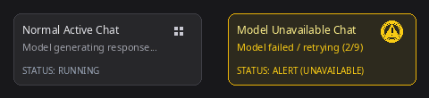
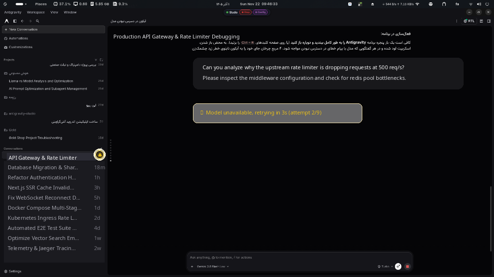

# ⚠️ Antigravity Model Hazard Indicator

[](https://github.com/programmer-1998/antigravity-chat-status-indicator)
[](https://opensource.org/licenses/MIT)
[](https://github.com/programmer-1998/antigravity-chat-status-indicator)

> Instant visual hazard alert for unresponsive AI models across background conversations in Google Antigravity.

---

## 📌 The Problem

When interacting with multiple conversations or long-running tasks in Google Antigravity, background models may occasionally become **Unavailable** or encounter connection timeouts (`Model unavailable, retrying in 3s (attempt 2/9)`).

Normally, the conversation item in the sidebar continues displaying the generic 2x2 grid loader animation. Developers working in other tabs remain unaware that an active conversation has failed until manually switching back to inspect it.



---

## 💡 The Solution

This tool replaces the standard background loader with a **luminous pulsing hazard indicator** whenever model availability fails:

1. **Immediate Visual Feedback**: A glowing hazard sign highlights the affected conversation in the sidebar.
2. **Context Preservation**: Hides standard running animations when a model is stuck or retrying.
3. **Non-Intrusive**: Pure SVG rendering with balanced glow styling that complements the dark interface.



---

## 🚀 Quick Start

### Installation

Clone the repository and run the patcher:

```bash
git clone https://github.com/programmer-1998/antigravity-chat-status-indicator.git
cd antigravity-chat-status-indicator

# Apply patch
node scripts/patch.mjs
```

Restart or refresh Antigravity (`Ctrl + R`) to activate.

### Uninstallation

To restore original defaults at any time:

```bash
node scripts/patch.mjs --unpatch
```

---

## ⚙️ How It Works

- The patcher inspects the desktop client bundle (`app.asar`) and adds a DOM observer on initialization.
- When an active or background execution encounters a retry or connection failure state, the standard loader element is hidden and a vectorized alert badge is inserted.
- Once the model recovers, the badge automatically clears and normal status indicators return.

---

## 📄 License

Distributed under the MIT License. See `LICENSE` for details.
